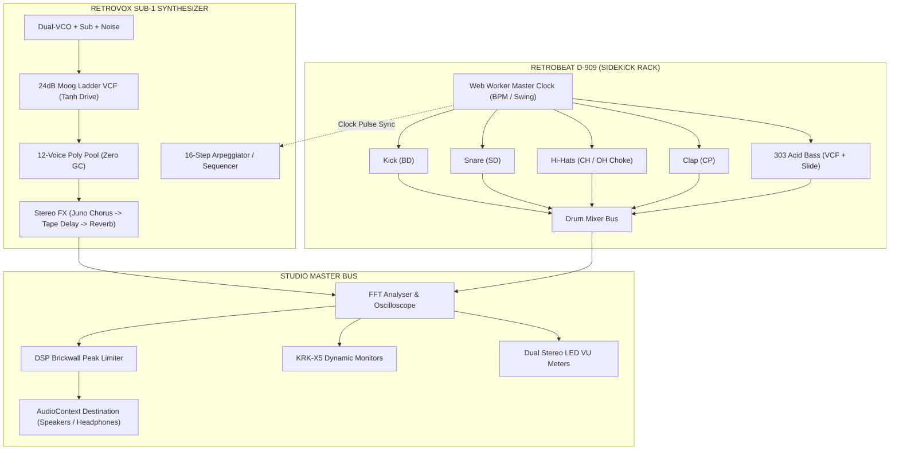

# 🎹 RETROVOX SUB-1 & RETROBEAT D-909 • Analog Synthesizer & Drum Studio

[](#)
[](#)
[](#)
[](#)
[](LICENSE)

Ein authentischer analoger Synthesizer (**RETROVOX SUB-1**) und eine DSP Drum & Acid Bass Machine (**RETROBEAT D-909**) direkt im Webbrowser – gebaut mit modernsten Web-Standards (HTML5, Vanilla CSS, Web Audio API, Web MIDI API, Web Workers).

---

### ⚡ NEU in v1.8.29: MOD ENV LOOP
- **🔁 LOOP:** Der Knopf LOOP im Display (Tab MOD ENV) lässt die Mod-Hüllkurve Attack und Decay wiederholen, solange die Taste gehalten wird: hoch auf 100 %, runter auf den Sustain-Wert, wieder hoch. So arbeitet sie wie ein LFO pro Note, der mit jedem Anschlag neu startet. Beim Loslassen folgt der Release. Das Display zeigt dann zwei Zyklen.

### ⚡ NEU in v1.8.27/v1.8.28: Mod-Hüllkurve und Hüllkurvenanzeige
- **📈 Anzeige:** Über den ADSR-Fadern zeigt ein kleines Display die Form der gewählten Hüllkurve (beide Synths). Die Zeitachse ist logarithmisch wie die Fader. Der Modultitel heißt nur noch DUAL ADSR, die Fader sind dafür etwas kürzer.
- **〽️ MOD ENV:** Dritter Tab im Hüllkurven-Modul des SUB-1. Die Mod-Hüllkurve ist nur eine Quelle in der Mod-Matrix (MOD ENV) und ist ab Werk nirgends angeschlossen. Sie wird mit dem Preset gespeichert.

### ⚡ NEU in v1.8.26: MOD MATRIX im Synth
- **⇄ MOD MATRIX:** Die Taste sitzt jetzt im Titel von Modul 04 // DUAL LFO & MOD statt in der Kopfleiste.

### ⚡ NEU in v1.8.25: Oszillator-Tabs
- **🎛️ OSC 1 / OSC 2 / SUB:** Das VCO-Modul zeigt wie das FX-Panel eine Seite pro Oszillator. OSC 1 und OSC 2 haben dieselben Regler: Welle, OCTAVE, SEMI, DETUNE und PULSE W. Neu sind SEMI und DETUNE für VCO 1 und eine eigene Pulsbreite für VCO 2. SYNC bleibt bei OSC 2, SUB OCT wandert in den Tab SUB. Alte Presets klingen unverändert.

### ⚡ NEU in v1.8.24: Effekte als Matrix-Ziele
- **⇄ FX-Ziele:** Die Mod-Matrix des SUB-1 moduliert jetzt auch das FX-Rack: CRUSH BITS, CRUSH RATE, DELAY TIME, DELAY FEEDBACK, DELAY MIX und REVERB MIX. LFOs und Mod Wheel wirken direkt; Hüllkurven, Velocity, Tonhöhe und Zufall folgen der zuletzt gespielten Note. CRUSH-Ziele klingen nur bei CRUSH MIX über 0.

### ⚡ NEU in v1.8.23: Kopfleiste auf dem iPad
- **🔄 RELOAD:** Unter 1366 px Breite zeigt DRUM RACK nur sein Symbol und "Was gibt's Neues?" nur ✨ und die Version. RELOAD und POWER rutschen auf dem iPad nicht mehr aus der Kopfleiste.

### ⚡ NEU in v1.8.21/v1.8.22: Mod-Matrix (SUB-1)
- **⇄ MOD MATRIX:** Die Taste MOD MATRIX (seit v1.8.26 in Modul 04) blendet eine Matrix mit 8 Slots ein. Jeder Slot verbindet eine Quelle (LFO 1/2, Filter- und Amp-Hüllkurve, Velocity, Tonhöhe, Zufall pro Note, Mod Wheel) mit einem Ziel (Pitch, Pitch VCO 2, Pulsbreite, Cutoff, Resonanz, Amp, Sub- und Noise-Pegel), die Menge geht von -100 % bis +100 %. Eine LED zeigt aktive Slots, das Keybed bleibt spielbar. Die Matrix wird mit dem Preset gespeichert; die festen LFO-Regler bleiben. Ungenutzte Slots und Quellen sind abgeklemmt und kosten keine Rechenzeit (v1.8.22).
- **💾 Alte Presets:** Fehlt einem älteren User-Preset ein neuer Parameter (Crusher, Matrix), lädt er den INIT-Wert, statt den laufenden Wert stehen zu lassen.

### ⚡ NEU in v1.8.18: Bitcrusher
- **👾 CRUSH:** Vierter Effekt im FX-Modul, vor Chorus, Delay und Reverb. BITS (16 bis 1) rastert die Lautstärke gröber, RATE (48 kHz bis 500 Hz) hält jeden Wert länger, MIX blendet zwischen Original und Lo-Fi. Bei MIX 0 rechnet der Effekt nicht mit. Beide Synths, gespeichert in Presets.

### ⚡ NEU in v1.8.17: HOLD ohne Arpeggiator
- **✋ HOLD:** Die HOLD-Taste hält den Akkord jetzt auch bei ARP OFF. Losgelassene Tasten klingen weiter und leuchten orange; der nächste Anschlag nach dem Loslassen ersetzt den Akkord. ARP ON übernimmt den gehaltenen Akkord, ARP OFF gibt ihn an die Stimmen zurück. HOLD aus, Power Off und Presetwechsel beenden ihn.

### ⚡ NEU in v1.8.16: Synth-Auswahl auf iPad und Handy
- **🎛️ Synth-Auswahl:** Unter 1280px Breite blendete das Layout die Auswahl oben links aus, auf iPad und Handy ließ sich der Synth nicht wechseln. Sie bleibt jetzt bei jeder Breite sichtbar, mit kleinerer Schrift.

### ⚡ NEU in v1.8.15: Saubere Updates
- **🔄 Kein Versionsmix mehr:** Nach einem Update lief beim ersten Aufruf die neue Seite kurz mit alten Scripts, neue Tasten hatten dann keine Funktion. Seite und Scripts kommen jetzt immer aus demselben Versions-Cache; die neue Version übernimmt mit einem automatischen Neuladen.

### ⚡ NEU in v1.8.14: Effekte mit Tasten
- **🎛️ FX-Tabs:** Oben im Effekt-Modul wählen die Tasten CHORUS, DELAY und REVERB, welcher Effekt seine Regler zeigt. Jeder Effekt hat so die volle Breite. Eine LED an jeder Taste leuchtet, solange der Effekt hörbar ist.

### ⚡ NEU in v1.8.13: RANDOM-Patch
- **🎲 RANDOM:** Die Taste neben INIT würfelt einen spielbaren Patch für den aktiven Synth (SUB-1 oder FM-4). Werte bleiben in musikalischen Grenzen, Oktave und Glide bleiben stehen. Gefällt der Klang, sichert SAVE ihn als User-Preset.

### ⚡ NEU in v1.8.12: Aufgeräumtes FM-Panel
- **📐 Mehr Platz:** Das Routing-Display zeigt nur noch die Grafik (ohne Kopfzeile), die Algorithmus-Spalte ist breiter, die Spalten Operatoren C & A und Feedback · Mix · Vib sind schmaler.
- **🎚️ Kompakter Chorus:** Der Regler C-MIX sitzt neben Titel und Modus-Tasten, der Chorus braucht eine Reihe weniger.

### ⚡ NEU in v1.8.11: FM-4, der zweite Synthesizer
- **🎛️ Synth-Auswahl:** Die Modellzeile oben links ist jetzt ein Auswahlfeld. Neben dem SUB-1 gibt es den RETROVOX FM-4; die Wahl lädt die Seite neu und bleibt gespeichert (direkt per `?synth=fm`).
- **📡 FM-4:** 4 Sinus-Operatoren C, A, B1, B2 mit Feinverstimmung, Pegel und eigener ADSR. 8 Algorithmen mit je einem Feedback-Operator und zwei Ausgängen X und Y, die der MIX-Regler überblendet; ein Routing-Display zeigt den gewählten Algorithmus. Ratios: C fast nur ganzzahlig, A mit unharmonischen Stufen, B1/B2 auf einem Regler wie Uhrzeiger. Ein AudioWorklet rechnet die Operatoren pro Sample. Vibrato (Mod Wheel vertieft es), dieselben Stereo-Effekte. 6 Factory-Presets: Tine Piano, Glass Bell, Slap Bass, FM Brass, Drawbar Organ, Marimba. User-Presets speichert jeder Synth getrennt.
- **❄️ Eigenes Gesicht:** Der FM-4 trägt kühles Blau-Stahl mit Aluminium-Seitenteilen statt Holz; jedes Poti zeigt seinen Wert als grün leuchtenden Ring.

### ⚡ NEU in v1.8.7: Keine hängenden Noten
- **🎹 Hängende Noten:** Gleiten mit mehreren Fingern konnte einen Ton dauerhaft klingen lassen, auch nach Power Off oder Presetwechsel. Die Engine verliert erneut angeschlagene Noten nicht mehr, und Power Off/Presetwechsel lassen jede klingende Stimme los.

### ⚡ NEU in v1.8.6: Weniger CPU-Last
- **⚡ Stille Stimmen schlafen:** Stimmen hängen nur noch am Audio-Bus, solange sie klingen, und die PWM-Formung läuft nur für VCOs mit Square. Gehaltene Akkorde brauchen etwa ein Drittel der Rechenzeit, das Knistern durch CPU-Überlast auf Tablets fällt weg.

### ⚡ NEU in v1.8.4: Kein Übersteuern am Ausgang
- **🛡️ Sicherheits-Clipper:** Der Limiter ließ Spitzen bis etwa 1,15 durch, die der Ausgang hart abschnitt und kratzen ließ (vor allem 06 // SCI-FI SAMPLE & HOLD ARP). Eine weiche Kennlinie hinter dem Limiter hält den Ausgang jetzt unter Vollaussteuerung.

### ⚡ NEU in v1.8.3: Sample & Hold ohne Knacken
- **🔇 Sample & Hold:** S&H hält jetzt flache Zufallsstufen statt eines skalierten Sägezahns. Das Knacken bei hoher VCF-Tiefe und Resonanz (Preset 06 // SCI-FI SAMPLE & HOLD ARP) ist weg, neue Noten springen nicht mehr auf volle Tiefe.

### ⚡ NEU in v1.8.2: Sample & Hold Fix, Arpeggiator Latch & neuer Unterbau
- **🎚️ Sample & Hold:** PITCH auf 100% bewegt die Tonhöhe um bis zu ±2 Halbtöne wie bei den anderen LFO-Wellen (bisher bis zu ±1 Oktave). AMP wirkt jetzt auch mit S&H.
- **🔁 Arpeggiator Latch:** LATCH übernimmt Noten, die beim Einschalten schon gehalten werden.
- **🎛️ Anzeigen:** VCO-2-SYNC folgt dem Preset, die Drum-SYNC-Taste zeigt beim Start den echten Zustand, BPM-Tasten und Tap-Tempo ziehen einen synchronisierten Arpeggiator mit.
- **🧪 Unterbau:** Code in kleinere Module aufgeteilt, 90 automatische Tests (`npm test`).

### ⚡ NEU in v1.8.0: Preset Manager In-Place Update & Poti-Ergonomie
- **💾 In-Place Preset Update & Save-As-New:** Eigene Sounds mit `💾 Überschreiben` direkt in-place aktualisieren oder über `Als Neu speichern` Varianten abzweigen.
- **🗑️ User-Preset Löschen:** Ungewollte User-Patches direkt aus dem Dialog sauber aus dem Browser-Speicher entfernen.
- **📐 100% Circular Potentiometers:** Durch striktes `aspect-ratio: 1 / 1` bleiben alle Drehregler (VCF Cutoff, Resonance, Arp Timing) auf allen Viewports, Desktops und Mobile-Landscape-Ansichten perfekt kreisrund ohne Ellipsenverzerrung.
- **⌨️ Keyboard Shortcuts:** <kbd>Enter</kbd> im Preset-Dialog speichert sofort, <kbd>Escape</kbd> schließt Dialoge.

---

## 🌟 Features & Highlights

### ⚡ NEU in v1.4.0: Progressive Web App (PWA) & 100% Offline Studio Engine
- **Installierbare Standalone Desktop- & Mobile-App**: Direkt aus dem Browser installierbar (Windows, macOS, Linux, iOS, Android) mit eigenem App-Fenster, Dock-Icon und schnellen App-Shortcuts (*Synthesizer Lab* & *D-909 Drum Rack*).
- **100% Offline DSP (Zero Network Dependencies)**: Alle Oszillatoren, Filter, Drums und 303-Basslines werden in Echtzeit per DSP berechnet – kein Audio-Streaming oder Sample-Download erforderlich. Funktioniert komplett ohne Internetverbindung im Flugzeug oder auf der Bühne.
- **Service Worker mit High-Performance App Shell & Dynamic Font Cache**: Lokale Speicherung aller Skripte, Stylesheets und Google Webfonts für 0ms Ladezeit.
- **Stage Mode (Screen Wake Lock API)**: Verhindert automatisches Abschalten des Displays während Live-Sessions und Sequenzer-Jams.
- **Safe-Area Inset Support**: Randloses Eintauchen auf Smartphones und Tablets mit Notches.

### 🥁 RETROBEAT D-909 Drum & Bass Machine (Sidekick Unit)
- **Einfahrbares Studio-Rack-Gerät**: Auf Knopfdruck (`Shift+D` oder rechter Seitenreiter) fährt von rechts ein vollwertiger analoger Drumcomputer mit Metall-Rack-Design ein.
- **5 Synthetisierte DSP Drum-Spuren (Zero Samples)**:
  - **BD (Bass Drum / Kick)**: Wuchtiger 909/808 Sub-Drop mit Klick-Transiente & Tanh-Sättigung.
  - **SD (Snare Drum)**: Dual-Tone Resonator + gefiltertes Rauschen (Snappy).
  - **CH / OH (Closed & Open Hi-Hat)**: 6-Oscillator Metallic-Cluster mit echter **Choke-Gruppe** (Closed schneidet Open ab).
  - **CP (Hand Clap)**: 3-fach Mikro-Impuls-Burst mit Auskling-Fahne.
- **Monophoner 303-Style Acid & Sub-Bass Synthesizer**:
  - Wählbare Sägezahn-/Rechteck-Wellenform, 24dB resonantes Tiefpassfilter, stufenloser Envelope-Mod, **Accent** und **Portamento / Slide**-Gleiten.
- **16-Step Matrix Sequenzer**:
  - 16 illuminierte Step-Tasten im legendären 808/909-Farbdesign (Rot, Orange, Gelb, Weiß).
  - 3-Stufen-Trigger: *Off* ➔ *Normal* ➔ *Accent* (erhöhte Dynamik & Filter-Punch).
  - Mute (M) und Solo (S) pro Spur sowie individuelle Lautstärkeregler.
- **Factory Kits & Pattern-Bänke**:
  - *909 Techno Club* (132 BPM)
  - *303 Acid Warehouse* (138 BPM)
  - *80s Synthwave Disco* (118 BPM)
  - *Drum & Bass Roller* (174 BPM)

### 🔗 Bi-Direktionale Master-Clock-Synchronisation
- **Master Precision Clock**: Die Drum Machine agiert als Master-Taktgeber mit isoliertem Web Worker Lookahead-Scheduler (20ms).
- **Arp Clock Sync**: Am Synthesizer kann per Knopfdruck auf `DRUM SYNC` umgeschaltet werden. Beide Geräte starten, stoppen und laufen absolut phasenstarr und ohne Tempo-Drift synchron im selben Takt!
- **Summierter Audio-Bus**: Die Drum Machine ist direkt an den Master-Analyser geroutet, sodass die dynamischen **KRK-X5 Nahfeldmonitore** und das CRT-Oszilloskop druckvoll mit den Beats und Basslines mitschwingen.

### 🛡️ DSP Audio Engine & Voice Architecture (RETROVOX SUB-1)
- **12-Stimmen Voice-Pooling (Zero GC Churn)**: Fester Pool aus 12 persistent verdrahteten Stimmen eliminiert Garbage-Collection-Ruckler und AudioNode-Allokationen während des Spielens vollständig.
- **LRU Voice Stealing**: Bei Auslastung aller 12 Stimmen wird die am längsten klingende Stimme mit einem 2ms-Anti-Click-Fadeout nahtlos übernommen.
- **Master Brickwall Limiter & Anti-Clipping**: Dedizierter Peak-Limiter fängt Pegelspitzen bei 0 dBFS zuverlässig ab.
- **Envelope De-Clicking**: Mathematisch kalibrierte Mindest-Attackzeit und asymptotisches Voice-Release verhindern jegliche Abreiß-Knackser.
- **Normalisierter Tanh Filter-Drive**: Hyperbeltangens-Sättigungskurve für stufenlose analoge Bandsättigung ohne Pegelsprünge ($y = \tanh(G \cdot x)/\tanh(G)$).

### 🎛️ Subtraktive Synthese & Modulation
- **Duale Oszillatoren (VCO 1 & VCO 2)**: Sägezahn, Rechteck (mit PWM), Dreieck, Sinus, Hard-Sync, Detune (Cents/Halbtöne) und Oktavwahlschalter.
- **Sub-Oszillator & Rauschen**: Wählbare Sub-Oktave (-1 oder -2 Oktaven) und kontinuierlich mischbares Weißes Rauschen.
- **24dB Resonantes Ladder-Filter (VCF)**: Tiefpass (24dB & 12dB), Bandpass und Hochpass mit kaskadierter Resonanz-Kompensation, Hüllkurven-Modulation und Keyboard Tracking.
- **Duale ADSR-Hüllkurven**: Getrennte, ultraschnelle Kurven für Filter (VCF) und Lautstärke (VCA).
- **Duales LFO Modulationsnetzwerk**: 2 unabhängige LFOs mit Multi-Wellenformen, echter **Sample & Hold**-Schaltung, Delay/Fade-In und flexiblem Routing auf Pitch, VCF, PWM und Amp.

### ⏱️ Studio FX & Konnektivität
- **Vintage Stereo FX Rack**:
  - **Roland Juno-Style BBD Stereo Chorus** (Modi: *Off*, *I*, *II*, *I+II*)
  - **Stereo Tape Delay / Echo** mit BPM-Sync, Spatial Stereo-Spread und High-Cut Dämpfung
  - **Studio Space Reverb** mit stufenlosem Raum-Decay und Mix
- **Web MIDI API**: Automatische Erkennung von Hardware-MIDI-Keyboards inkl. Pitch-Bend, Mod-Wheel, Velocity und Sustain-Pedal.
- **Preset-Verwaltung**: 10 handgefertigte Werks-Presets, lokale Speicherfunktion für eigene User-Presets und JSON Export/Import.

---

## 🎧 Studio-Signalfluss & Architektur



---

## 🚀 Schnellstart

Das Projekt benötigt **keinen Build-Prozess** und hat **keine externen Abhängigkeiten**.

### Option 1: Direkt im Browser öffnen
Einfach die Datei `index.html` per Doppelklick in einem modernen Webbrowser (Chrome, Edge, Firefox, Brave, Safari) öffnen.

### Option 2: Mit lokalem Webserver
```bash
# Repository klonen
git clone https://github.com/the3ver/websynth.git
cd websynth

# Lokalen Webserver starten
npx serve .
# oder mit Python: python -m http.server 8000
```
Öffne anschließend [http://localhost:3000](http://localhost:3000) (oder den im Terminal angezeigten Port).

---

## 🎹 Tastatur-Steuerung (Computer Keyboard & Shortcuts)

- **Synthesizer Klaviatur spielen**:
  - Weiße Tasten: <kbd>A</kbd> (C3), <kbd>S</kbd> (D3), <kbd>D</kbd> (E3), <kbd>F</kbd> (F3), <kbd>G</kbd> (G3), <kbd>H</kbd> (A3), <kbd>J</kbd> (B3), <kbd>K</kbd> (C4), <kbd>Ö</kbd> (D4)
  - Schwarze Tasten: <kbd>W</kbd> (C#3), <kbd>E</kbd> (D#3), <kbd>T</kbd> (F#3), <kbd>Z</kbd> / <kbd>Y</kbd> (G#3), <kbd>U</kbd> (A#3), <kbd>O</kbd> (C#4), <kbd>P</kbd> (D#4)
- **Oktaven umschalten**: <kbd>X</kbd> (Oktave höher), <kbd>Z</kbd> (Oktave tiefer)
- **Drum & Bass Machine**: <kbd>Shift</kbd> + <kbd>D</kbd> (Rack ein-/ausfahren)

---

## 🔌 Hardware Web MIDI Setup

1. Schließe dein USB- oder Bluetooth-MIDI-Keyboard an deinen Computer an.
2. Öffne den **RETROVOX SUB-1** im Browser.
3. Die MIDI-Statusanzeige in der oberen Leiste wechselt automatisch auf `MIDI: 1 DEVICE CONNECTED`.
4. Unterstützte MIDI-Befehle:
   - `Note On` / `Note Off` (mit Velocity-Dynamik)
   - `Pitch Bend` (Wheel / Lever)
   - `Control Change #1` (Modulation Wheel)
   - `Control Change #64` (Sustain Pedal)
   - `All Notes Off` / `Panic`

---

## 📁 Projektstruktur

```
websynth/
├── .github/
│   └── workflows/
│       └── deploy.yml      # Automatische GitHub Pages CI/CD Pipeline
├── css/
│   └── style.css           # Vollständiges High-End Analog-Studio UI & Rack-Styling
├── js/
│   ├── app.js              # Initialisierung, Master Controls & Version State
│   ├── audio-engine.js     # Web Audio Engine (Voice-Pool, LFOs, Setter, MIDI)
│   ├── voice.js            # Eine Synth-Stimme (VCOs, VCF, VCA, LFO-Routing)
│   ├── fx-chain.js         # Chorus, Delay, Reverb
│   ├── synth-params.js     # Parameter-Tabelle für Presets, Knobs und UI-Sync
│   ├── arp-engine.js       # 16-Step Arpeggiator & Master-Sync Slave
│   ├── drum-engine.js      # DSP Drum & 303 Bass Synthesis, Web Worker Master Clock
│   ├── drum-kits.js        # Drum Factory Kits
│   ├── drum-ui.js          # Drum Machine Drawer UI, Step Matrix, Kits & Mutes
│   ├── presets.js          # Factory Preset Library
│   ├── preset-store.js     # User-Presets im localStorage
│   ├── preset-panel.js     # Preset-LCD & Speichern-Dialog
│   ├── controls.js         # Knobs, Fader, Pitch-/Mod-Wheel
│   ├── knob-scale.js       # Knob-Skalierung & Anzeigeformate
│   ├── virtual-keyboard.js # Tastatur, Touch & PC-Hotkeys
│   ├── visualizer.js       # Oszilloskop, VU-Meter, Woofer
│   ├── dom-utils.js        # Kleine DOM-Helfer
│   ├── pwa-manager.js      # PWA-Lebenszyklus & Offline-Status
│   └── synth-ui.js         # Synth-Panel (verbindet alle Bedienelemente)
├── test/                   # node:test Unit-Tests (npm test)
├── .gitignore              # Git Ignore Konfiguration
├── AGENTS.md               # Entwickler- & Agent-Architekturleitfaden
├── index.html              # Synthesizer Studio HTML5 Markup
├── LICENSE                 # MIT Lizenz
├── package.json            # Projekt-Metadaten & Hilfsskripte (v1.3.0)
└── README.md               # Dokumentation
```

---

## 🛠️ Technologien

- **Web Audio API** (`AudioContext`, `OscillatorNode`, `BiquadFilterNode`, `GainNode`, `WaveShaperNode`, `DelayNode`, `ConvolverNode`, `AnalyserNode`, `DynamicsCompressorNode`)
- **Web Workers** (Inline Worker via Blob URL für hochpräzise Master-Clock)
- **Web MIDI API** (`navigator.requestMIDIAccess`)
- **Vanilla JavaScript (ES6+)**
- **Modern CSS3** (Custom Properties, Flexbox, Grid, Glassmorphism, CSS Transitions & Keyframes)
- **Google Fonts** (*Chakra Petch*, *Inter*, *JetBrains Mono*)

---

## 📄 Lizenz

Dieses Projekt ist unter der **[MIT Lizenz](LICENSE)** lizenziert – freie Nutzung für private und kommerzielle Zwecke.
