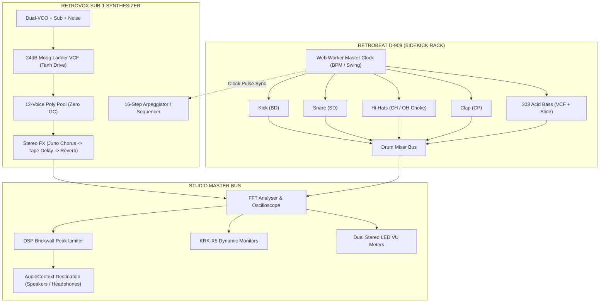

# 🎹 RETROVOX SUB-1 & RETROBEAT D-909 • Analog Synthesizer & Drum Studio

[](#)
[](#)
[](#)
[](#)
[](LICENSE)

**[English](#english) · [Deutsch](#deutsch)**

---

<a id="english"></a>

## 🇬🇧 English

An analog-style synthesizer (**RETROVOX SUB-1**), a 4-operator FM synthesizer (**RETROVOX FM-4**) and a DSP drum & acid bass machine (**RETROBEAT D-909**) right in the web browser, built on web standards only (HTML5, vanilla CSS, Web Audio API, Web MIDI API, Web Workers).

---

#### ⚡ NEW in v1.8.43: Krell patch for the SUB-1
- **🎲 11 // KRELL PATCH:** A factory preset in the spirit of the Buchla/Todd Barton Krell patch. Hold a key (or use HOLD) and the SUB-1 plays by itself: about once a second a short pluck, its pitch stepping at random up to 8 semitones up or down, about once per pluck (not tied to a scale), the filter wandering on a second random LFO, with long delay and reverb. Built from existing parts only: MOD ENV LOOP, both LFOs on sample & hold and all eight mod matrix slots, so you can take it apart and change it.

#### ⚡ NEW in v1.8.42: Turn knobs while holding a key
- **🖐️ Multi-touch:** On touch screens a knob, fader or wheel follows the finger that touched it. Before, it followed the first finger on the screen: with a key held first, the knob did not move; with the knob first, releasing the key stopped the knob. Now you can hold notes and turn knobs in any order.

#### ⚡ NEW in v1.8.41: Octave down with the Y key
- **⌨️ Octave down:** On the computer keyboard Y (left of X, German layout) shifts the octave down again, X shifts it up. Before, Y played G#3 like Z and no key shifted the octave down. G#3 sits on Z between T and U, and the on-screen key now shows Z.

#### ⚡ NEW in v1.8.40: Delay in time with the arpeggiator
- **⏱️ SYNC:** The delay page in the FX rack has the buttons FREE and SYNC. With SYNC the NOTE knob replaces the TIME knob: 1/16 to 1/1, plus dotted (e.g. 1/8.) and triplet (e.g. 1/8T). Works on SUB-1 and FM-4.
- **🥁 Tempo:** The delay time follows the tempo the arpeggiator uses right now: the BPM knob (INT CLK) or the drum clock (DRUM SYNC). Tempo changes glide without clicks. The delay time now reaches 3 s (right channel 4 s), e.g. a whole note at 80 BPM.
- **💾 Presets:** SYNC and the note value are saved in the preset, the tempo is not. Older presets load with FREE and sound as before. The mod matrix modulates DELAY TIME in SYNC mode too, around the synced time.

#### ⚡ NEW in v1.8.39: FM-4 algorithm display shows only the graphic, narrower module
- **🔀 Display:** The FM-4 algorithm display shows only the routing picture, without a text line. The graphic fills the display up to a narrow margin, every algorithm sits centred. The display has the same fixed size on every device (105 × 156 px). On desktop and iPad the whole module 02 is only as wide as the display, the eight algorithm buttons sit compactly above it; the other modules get the width gained. The routing as text is in the tooltip of the algorithm buttons.

#### ⚡ NEW in v1.8.35: MIDI keyboard on iPad and iPhone
- **🔌 Connected right away:** RETROVOX connects to the MIDI keyboard when the page loads, also in iOS browsers with Web MIDI (e.g. Web MIDI Browser). The first note from the keyboard starts the audio, as far as the browser allows it.
- **🏷️ Status:** The MIDI field also shows MIDI: ERROR (access denied) and MIDI: NOT SUPPORTED (browser without Web MIDI).
- **⏱️ Devices:** Keyboards that are detected late, like the Arturia KeyStep, appear after up to 2 seconds.

#### ⚡ NEW in v1.8.34: MIDI keyboard with arpeggiator and HOLD
- **🎹 MIDI:** Notes from the MIDI keyboard now go through the arpeggiator and HOLD like the on-screen keyboard; velocity is kept. RETROVOX listens on all 16 channels (omni). Web MIDI works in Chrome, Edge and iOS browsers with Web MIDI, not in Safari.

#### ⚡ NEW in v1.8.33: Single-line labels
- **🏷️ Titles and buttons:** Module titles, filter type buttons and section headers stay on one line: 01 // DUAL VCO, 02 // MIXER, 03 // VCF 24dB, 06 // FX RACK, LP24/LP12, BBD CHORUS; on the FM-4 01 // OPS C & A, 03 // OPS B1 & B2, 04 // FB · MIX, 05 // OP ENV, OP C/A/B1/B2, VIBRATO +WHEEL. A module title that is too long ends with … instead of wrapping.

#### ⚡ NEW in v1.8.32: Full-width envelope display, MATRIX next to RANDOM
- **📈 Display:** The envelope always fills the whole display and sits centred; the stage widths show their proportions to each other.
- **⇄ MATRIX:** The button for the mod matrix now sits in the preset bar next to RANDOM; the title of module 04 stays on one line.

#### ⚡ NEW in v1.8.31: Wider filter module
- **↔️ Layout:** On desktop the FX module is narrower (133 instead of 183 px at a window width of 1180 px), the VCF module wider (161 instead of 137 px). The FX tabs are called CHO, DLY, REV and BIT for that; the full names are in the tooltip and above every effect page.

#### ⚡ NEW in v1.8.30: Short tab labels
- **🏷️ Tabs:** All tab labels stay on one line. The envelope tabs are called VCA, VCF and MOD, the LFO tabs LFO 1 and LFO 2 (details in the tooltip).

#### ⚡ NEW in v1.8.29: MOD ENV LOOP
- **🔁 LOOP:** The LOOP button in the display (tab MOD ENV) makes the mod envelope repeat attack and decay as long as the key is held: up to 100 %, down to the sustain level, up again. It then works like a per-note LFO that restarts with every key press. On release the release stage follows. The display then shows two cycles.

#### ⚡ NEW in v1.8.27/v1.8.28: Mod envelope and envelope display
- **📈 Display:** Above the ADSR faders a small display shows the shape of the selected envelope (both synths). The time axis is logarithmic like the faders. The module title is just DUAL ADSR, and the faders are a little shorter for it.
- **〽️ MOD ENV:** Third tab in the envelope module of the SUB-1. The mod envelope is only a source in the mod matrix (MOD ENV) and is not connected anywhere by default. It is saved with the preset.

#### ⚡ NEW in v1.8.26: MOD MATRIX in the synth
- **⇄ MOD MATRIX:** The button now sits in the title of module 04 // DUAL LFO & MOD instead of in the header.

#### ⚡ NEW in v1.8.25: Oscillator tabs
- **🎛️ OSC 1 / OSC 2 / SUB:** Like the FX panel, the VCO module shows one page per oscillator. OSC 1 and OSC 2 have the same controls: wave, OCTAVE, SEMI, DETUNE and PULSE W. New are SEMI and DETUNE for VCO 1 and a pulse width of its own for VCO 2. SYNC stays with OSC 2, SUB OCT moves to the SUB tab. Old presets sound unchanged.

#### ⚡ NEW in v1.8.24: Effects as matrix targets
- **⇄ FX targets:** The SUB-1 mod matrix now also modulates the FX rack: CRUSH BITS, CRUSH RATE, DELAY TIME, DELAY FEEDBACK, DELAY MIX and REVERB MIX. LFOs and the mod wheel act directly; envelopes, velocity, key and random follow the last note played. CRUSH targets are audible only with CRUSH MIX above 0.

#### ⚡ NEW in v1.8.23: Header on the iPad
- **🔄 RELOAD:** Below 1366 px width DRUM RACK shows only its icon and "Was gibt's Neues?" only ✨ and the version. RELOAD and POWER no longer slide out of the header on the iPad.

#### ⚡ NEW in v1.8.21/v1.8.22: Mod matrix (SUB-1)
- **⇄ MOD MATRIX:** The MATRIX button (next to RANDOM since v1.8.32) opens a matrix with 8 slots. Each slot connects a source (LFO 1/2, filter and amp envelope, velocity, key, random per note, mod wheel) to a target (pitch, pitch VCO 2, pulse width, cutoff, resonance, amp, sub and noise level), the amount goes from -100 % to +100 %. An LED shows active slots, the keybed stays playable. The matrix is saved with the preset; the fixed LFO knobs stay. Unused slots and sources are unplugged and cost no processing time (v1.8.22).
- **💾 Old presets:** If an older user preset lacks a new parameter (crusher, matrix), it loads the INIT value instead of keeping the running value.

#### ⚡ NEW in v1.8.18: Bitcrusher
- **👾 CRUSH:** Fourth effect in the FX module, before chorus, delay and reverb. BITS (16 to 1) quantizes the level more coarsely, RATE (48 kHz to 500 Hz) holds every value longer, MIX blends between original and lo-fi. At MIX 0 the effect does not compute. Both synths, saved in presets.

#### ⚡ NEW in v1.8.17: HOLD without arpeggiator
- **✋ HOLD:** The HOLD button now holds the chord with ARP OFF too. Released keys keep sounding and light up orange; the next key press after releasing replaces the chord. ARP ON takes over the held chord, ARP OFF hands it back to the voices. HOLD off, power off and a preset change end it.

#### ⚡ NEW in v1.8.16: Synth selection on iPad and phone
- **🎛️ Synth selection:** Below 1280 px width the layout hid the selection at the top left, so the synth could not be switched on iPad and phone. It now stays visible at every width, with a smaller font.

#### ⚡ NEW in v1.8.15: Clean updates
- **🔄 No more version mix:** After an update the first visit ran the new page briefly with old scripts, and new buttons did nothing. Page and scripts now always come from the same version cache; the new version takes over with an automatic reload.

#### ⚡ NEW in v1.8.14: Effects with buttons
- **🎛️ FX tabs:** At the top of the effect module the buttons CHORUS, DELAY and REVERB choose which effect shows its controls. Each effect gets the full width. An LED on each button lights up as long as the effect is audible.

#### ⚡ NEW in v1.8.13: RANDOM patch
- **🎲 RANDOM:** The button next to INIT rolls a playable patch for the active synth (SUB-1 or FM-4). Values stay within musical limits, octave and glide stay as they are. If you like the sound, SAVE stores it as a user preset.

#### ⚡ NEW in v1.8.12: Tidier FM panel
- **📐 More room:** The routing display shows only the graphic (without a header line), the algorithm column is wider, the columns operators C & A and feedback · mix · vib are narrower.
- **🎚️ Compact chorus:** The C-MIX knob sits next to the title and the mode buttons, the chorus needs one row less.

#### ⚡ NEW in v1.8.11: FM-4, the second synthesizer
- **🎛️ Synth selection:** The model line at the top left is now a selection field. Next to the SUB-1 there is the RETROVOX FM-4; the choice reloads the page and is remembered (directly via `?synth=fm`).
- **📡 FM-4:** 4 sine operators C, A, B1, B2 with fine detune, level and an ADSR of their own. 8 algorithms, each with one feedback operator and two outputs X and Y that the MIX knob crossfades; a routing display shows the selected algorithm. Ratios: C almost only whole numbers, A with inharmonic steps, B1/B2 on one knob like clock hands. An AudioWorklet computes the operators per sample. Vibrato (the mod wheel deepens it), the same stereo effects. 6 factory presets: Tine Piano, Glass Bell, Slap Bass, FM Brass, Drawbar Organ, Marimba. Each synth stores its user presets separately.
- **❄️ A face of its own:** The FM-4 wears cool blue steel with aluminium side panels instead of wood; every knob shows its value as a green glowing ring.

#### ⚡ NEW in v1.8.7: No stuck notes
- **🎹 Stuck notes:** Gliding with several fingers could leave a note sounding for good, even after power off or a preset change. The engine no longer loses re-struck notes, and power off and preset changes release every sounding voice.

#### ⚡ NEW in v1.8.6: Less CPU load
- **⚡ Silent voices sleep:** Voices are connected to the audio bus only while they sound, and the PWM shaping runs only for VCOs on square. Held chords need about a third of the processing time, and the crackle from CPU overload on tablets is gone.

#### ⚡ NEW in v1.8.4: No clipping at the output
- **🛡️ Safety clipper:** The limiter let peaks of about 1.15 through, which the output cut off hard and made crackle (above all 06 // SCI-FI SAMPLE & HOLD ARP). A soft curve behind the limiter now keeps the output below full scale.

#### ⚡ NEW in v1.8.3: Sample & hold without clicks
- **🔇 Sample & hold:** S&H now holds flat random steps instead of a scaled sawtooth. The clicks at high VCF depth and resonance (preset 06 // SCI-FI SAMPLE & HOLD ARP) are gone, and new notes no longer jump to full depth.

#### ⚡ NEW in v1.8.2: Sample & hold fix, arpeggiator latch and a new base
- **🎚️ Sample & hold:** PITCH at 100% moves the pitch by up to ±2 semitones like the other LFO waves (before: up to ±1 octave). AMP now works with S&H too.
- **🔁 Arpeggiator latch:** LATCH takes over notes that are already held when it is switched on.
- **🎛️ Displays:** VCO 2 SYNC follows the preset, the drum SYNC button shows the real state at start, BPM buttons and tap tempo carry a synced arpeggiator along.
- **🧪 Base:** Code split into smaller modules, 90 automated tests (`npm test`).

#### ⚡ NEW in v1.8.0: Preset manager in-place update and knob ergonomics
- **💾 In-place preset update and save as new:** Update your own sounds in place with `💾 Überschreiben` or branch off variants with `Als Neu speichern`.
- **🗑️ Delete user presets:** Remove unwanted user patches from browser storage right from the dialog.
- **📐 Round knobs:** A strict `aspect-ratio: 1 / 1` keeps every knob (VCF cutoff, resonance, arp timing) perfectly round on every viewport, desktop and mobile landscape, without elliptic distortion.
- **⌨️ Keyboard shortcuts:** <kbd>Enter</kbd> in the preset dialog saves right away, <kbd>Escape</kbd> closes dialogs.

---

### 🌟 Features & highlights

#### ⚡ NEW in v1.4.0: Progressive web app (PWA) and 100% offline studio engine
- **Installable standalone desktop and mobile app**: Installs right from the browser (Windows, macOS, Linux, iOS, Android) with its own app window, dock icon and quick app shortcuts (*Synthesizer Lab* and *D-909 Drum Rack*).
- **100% offline DSP (no network dependencies)**: All oscillators, filters, drums and 303 basslines are computed in real time by DSP, with no audio streaming or sample download. Works entirely without an internet connection, on a plane or on stage.
- **Service worker with app shell and font cache**: Stores every script, stylesheet and Google web font locally, so the app loads instantly.
- **Stage mode (Screen Wake Lock API)**: Keeps the display from switching off during live sessions and sequencer jams.
- **Safe-area inset support**: Edge-to-edge layout on phones and tablets with notches.

#### 🥁 RETROBEAT D-909 drum & bass machine (sidekick unit)
- **Slide-in studio rack unit**: At the push of a button (`Shift+D` or the tab on the right) a full analog-style drum computer in a metal rack design slides in from the right.
- **5 synthesized DSP drum tracks (no samples)**:
  - **BD (bass drum / kick)**: Heavy 909/808 sub drop with click transient and tanh saturation.
  - **SD (snare drum)**: Dual-tone resonator plus filtered noise (snappy).
  - **CH / OH (closed and open hi-hat)**: 6-oscillator metallic cluster with a real **choke group** (closed cuts off open).
  - **CP (hand clap)**: Triple micro impulse burst with a decaying tail.
- **Monophonic 303-style acid and sub bass synthesizer**:
  - Selectable sawtooth/square wave, 24dB resonant lowpass filter, continuous envelope mod, **accent** and **portamento / slide**.
- **16-step matrix sequencer**:
  - 16 lit step buttons in the classic 808/909 colours (red, orange, yellow, white).
  - 3-stage trigger: *Off* ➔ *Normal* ➔ *Accent* (more dynamics and filter punch).
  - Mute (M) and solo (S) per track plus individual volume knobs.
- **Factory kits and pattern banks**:
  - *909 Techno Club* (132 BPM)
  - *303 Acid Warehouse* (138 BPM)
  - *80s Synthwave Disco* (118 BPM)
  - *Drum & Bass Roller* (174 BPM)

#### 🔗 Two-way master clock sync
- **Master precision clock**: The drum machine is the master clock with an isolated Web Worker lookahead scheduler (20ms).
- **Arp clock sync**: On the synthesizer one button switches to `DRUM SYNC`. Both units start, stop and run phase-locked in the same beat, without tempo drift.
- **Summed audio bus**: The drum machine is routed straight to the master analyser, so the **KRK-X5 near-field monitors** and the CRT oscilloscope move with the beats and basslines.

#### 🛡️ DSP audio engine and voice architecture (RETROVOX SUB-1)
- **12-voice pool (no GC churn)**: A fixed pool of 12 persistently wired voices removes garbage collection stutter and AudioNode allocations while playing.
- **LRU voice stealing**: When all 12 voices are busy, the voice that has sounded longest is taken over with a 2ms anti-click fade-out.
- **Master brickwall limiter and anti-clipping**: A dedicated peak limiter catches level peaks at 0 dBFS.
- **Envelope de-clicking**: A calibrated minimum attack time and an asymptotic voice release prevent clicks when notes start or stop.
- **Normalized tanh filter drive**: A hyperbolic tangent saturation curve for continuous analog-style saturation without level jumps ($y = \tanh(G \cdot x)/\tanh(G)$).

#### 🎛️ Subtractive synthesis and modulation
- **Dual oscillators (VCO 1 and VCO 2)**: Sawtooth, square (with PWM), triangle, sine, hard sync, detune (cents/semitones) and octave switches.
- **Sub oscillator and noise**: Selectable sub octave (-1 or -2 octaves) and continuously mixable white noise.
- **24dB resonant ladder filter (VCF)**: Lowpass (24dB and 12dB), bandpass and highpass with cascaded resonance compensation, envelope modulation and keyboard tracking.
- **Dual ADSR envelopes**: Separate, very fast envelopes for filter (VCF) and amplitude (VCA).
- **Dual LFO modulation network**: 2 independent LFOs with several waveforms, real **sample & hold**, delay/fade-in and flexible routing to pitch, VCF, PWM and amp.

#### ⏱️ Studio FX and connectivity
- **Vintage stereo FX rack**:
  - **Roland Juno-style BBD stereo chorus** (modes: *Off*, *I*, *II*, *I+II*)
  - **Stereo tape delay / echo** with BPM sync, stereo spread and high-cut damping
  - **Studio space reverb** with continuous room decay and mix
- **Web MIDI API**: Detects hardware MIDI keyboards automatically, including pitch bend, mod wheel, velocity and sustain pedal.
- **Preset management**: 11 hand-made factory presets, local storage for your own user presets and JSON export/import.

---

### 🎧 Studio signal flow and architecture



---

### 🚀 Quick start

The project needs **no build step** and has **no runtime dependencies**.

#### Option 1: Open it in the browser
Double-click `index.html` to open it in a modern web browser (Chrome, Edge, Firefox, Brave, Safari).

#### Option 2: With a local web server
```bash
# Clone the repository
git clone https://github.com/the3ver/websynth.git
cd websynth

# Start a local web server
npx serve .
# or with Python: python -m http.server 8000
```
Then open [http://localhost:3000](http://localhost:3000) (or the port shown in the terminal).

---

### 🎹 Computer keyboard and shortcuts

- **Play the synthesizer keybed** (key positions of a German QWERTZ layout):
  - White keys: <kbd>A</kbd> (C3), <kbd>S</kbd> (D3), <kbd>D</kbd> (E3), <kbd>F</kbd> (F3), <kbd>G</kbd> (G3), <kbd>H</kbd> (A3), <kbd>J</kbd> (B3), <kbd>K</kbd> (C4), <kbd>L</kbd> (D4), <kbd>Ö</kbd> (E4), <kbd>Ä</kbd> (F4)
  - Black keys: <kbd>W</kbd> (C#3), <kbd>E</kbd> (D#3), <kbd>T</kbd> (F#3), <kbd>Z</kbd> (G#3), <kbd>U</kbd> (A#3), <kbd>O</kbd> (C#4), <kbd>P</kbd> (D#4), <kbd>Ü</kbd> (F#4)
- **Switch octaves**: <kbd>X</kbd> (octave up), <kbd>Y</kbd> (octave down)
- **Drum & bass machine**: <kbd>Shift</kbd> + <kbd>D</kbd> (slide the rack in/out)

---

### 🔌 Hardware Web MIDI setup

1. Connect your USB or Bluetooth MIDI keyboard to your computer.
2. Open the **RETROVOX SUB-1** in the browser.
3. The MIDI status in the top bar switches to `MIDI: 1 DEVICE CONNECTED` on its own.
4. Supported MIDI messages:
   - `Note On` / `Note Off` (with velocity)
   - `Pitch Bend` (wheel / lever)
   - `Control Change #1` (modulation wheel)
   - `Control Change #64` (sustain pedal)
   - `All Notes Off` / `Panic`

---

### 📁 Project structure

```
websynth/
├── .github/
│   └── workflows/
│       └── deploy.yml      # GitHub Pages CI/CD pipeline
├── css/
│   └── style.css           # Analog studio UI and rack styling
├── js/
│   ├── app.js              # Start-up, master controls and version state
│   ├── audio-engine.js     # Web Audio engine (voice pool, LFOs, setters, MIDI)
│   ├── voice.js            # One synth voice (VCOs, VCF, VCA, LFO routing)
│   ├── fx-chain.js         # Chorus, delay, reverb
│   ├── synth-params.js     # Parameter table for presets, knobs and UI sync
│   ├── arp-engine.js       # 16-step arpeggiator and master sync slave
│   ├── drum-engine.js      # DSP drum and 303 bass synthesis, Web Worker master clock
│   ├── drum-kits.js        # Drum factory kits
│   ├── drum-ui.js          # Drum machine drawer UI, step matrix, kits and mutes
│   ├── presets.js          # Factory preset library
│   ├── preset-store.js     # User presets in localStorage
│   ├── preset-panel.js     # Preset LCD and save dialog
│   ├── controls.js         # Knobs, faders, pitch and mod wheel
│   ├── knob-scale.js       # Knob scaling and readout formats
│   ├── virtual-keyboard.js # Keybed, touch and PC hotkeys
│   ├── visualizer.js       # Oscilloscope, VU meters, woofers
│   ├── dom-utils.js        # Small DOM helpers
│   ├── pwa-manager.js      # PWA lifecycle and offline state
│   └── synth-ui.js         # Synth panel (connects all controls)
├── test/                   # node:test unit tests (npm test)
├── .gitignore              # Git ignore configuration
├── AGENTS.md               # Developer and agent guide
├── index.html              # Synthesizer studio HTML5 markup
├── LICENSE                 # MIT license
├── package.json            # Project metadata and helper scripts
└── README.md               # Documentation
```

The full, current file map is in [docs/architecture.md](docs/architecture.md).

---

### 🛠️ Technologies

- **Web Audio API** (`AudioContext`, `OscillatorNode`, `BiquadFilterNode`, `GainNode`, `WaveShaperNode`, `DelayNode`, `ConvolverNode`, `AnalyserNode`, `DynamicsCompressorNode`, `AudioWorkletNode`)
- **Web Workers** (inline worker via Blob URL for the master clock)
- **Web MIDI API** (`navigator.requestMIDIAccess`)
- **Vanilla JavaScript (ES6+)**
- **Modern CSS3** (custom properties, flexbox, grid, glassmorphism, transitions and keyframes)
- **Google Fonts** (*Chakra Petch*, *Inter*, *JetBrains Mono*)

---

### 📄 License

This project is licensed under the **[MIT license](LICENSE)**: free to use for private and commercial purposes.

---

<a id="deutsch"></a>

## 🇩🇪 Deutsch

Ein authentischer analoger Synthesizer (**RETROVOX SUB-1**), ein FM-Synthesizer mit 4 Operatoren (**RETROVOX FM-4**) und eine DSP Drum & Acid Bass Machine (**RETROBEAT D-909**) direkt im Webbrowser – gebaut mit modernsten Web-Standards (HTML5, Vanilla CSS, Web Audio API, Web MIDI API, Web Workers).

---

#### ⚡ NEU in v1.8.43: Krell-Patch für den SUB-1
- **🎲 11 // KRELL PATCH:** Ein Factory-Preset im Geist des Krell-Patches von Buchla und Todd Barton. Taste halten (oder HOLD) und der SUB-1 spielt von selbst: etwa jede Sekunde ein kurzer Zupfer, die Tonhöhe springt zufällig bis zu 8 Halbtöne nach oben oder unten, etwa bei jedem Zupfer (an keine Tonleiter gebunden), das Filter wandert auf einem zweiten Zufalls-LFO, dazu langes Delay und Hall. Gebaut nur aus vorhandenen Teilen: MOD ENV LOOP, beide LFOs auf Sample & Hold und alle acht Slots der Mod-Matrix, zum Zerlegen und Verändern.

#### ⚡ NEU in v1.8.42: Regler drehen, während eine Taste gehalten wird
- **🖐️ Multitouch:** Auf Touch-Displays folgt ein Regler, Fader oder Rad dem Finger, der ihn berührt hat. Bisher folgte er dem ersten Finger auf dem Bildschirm: Lag zuerst ein Finger auf einer Taste, bewegte sich der Regler nicht; kam der Regler zuerst, stoppte er beim Loslassen der Taste. Jetzt lassen sich Noten halten und Regler drehen, in beliebiger Reihenfolge.

#### ⚡ NEU in v1.8.41: Oktave tiefer mit der Taste Y
- **⌨️ Oktave tiefer:** Auf der Computertastatur schaltet Y (links neben X) die Oktave wieder tiefer, X höher. Vorher spielte Y wie Z ein G#3, und keine Taste schaltete die Oktave tiefer. G#3 liegt auf Z zwischen T und U, die Bildschirmtaste zeigt jetzt Z.

#### ⚡ NEU in v1.8.40: Delay im Takt des Arpeggiators
- **⏱️ SYNC:** Die Delay-Seite im FX-Rack hat die Tasten FREE und SYNC. Bei SYNC ersetzt der Regler NOTE den TIME-Regler: 1/16 bis 1/1, dazu punktiert (z. B. 1/8.) und triolisch (z. B. 1/8T). Gilt für SUB-1 und FM-4.
- **🥁 Tempo:** Die Delay-Zeit folgt dem Tempo, das der Arpeggiator gerade nutzt: dem BPM-Regler (INT CLK) oder dem Drum-Takt (DRUM SYNC). Tempowechsel gleiten ohne Knacken. Die Delay-Zeit reicht jetzt bis 3 s (rechter Kanal 4 s), z. B. eine ganze Note bei 80 BPM.
- **💾 Presets:** SYNC und Notenwert werden im Preset gespeichert, das Tempo nicht. Ältere Presets laden mit FREE und klingen wie bisher. Die Mod-Matrix moduliert DELAY TIME auch im SYNC-Modus, um die synchrone Zeit herum.

#### ⚡ NEU in v1.8.39: FM-4 Algorithmus-Display nur mit Grafik, schmaleres Modul
- **🔀 Display:** Das Algorithmus-Display des FM-4 zeigt nur noch das Routing-Bild, ohne Textzeile. Die Grafik füllt das Display bis auf einen schmalen Rand, jeder Algorithmus sitzt mittig. Das Display hat auf allen Geräten dieselbe feste Größe (105 × 156 px). Auf Desktop und iPad ist das ganze Modul 02 nur so breit wie das Display, die acht Algorithmus-Tasten sitzen kompakt darüber; die gewonnene Breite bekommen die anderen Module. Das Routing als Text steht im Tooltip der Algorithmus-Tasten.

#### ⚡ NEU in v1.8.35: MIDI-Keyboard auf iPad und iPhone
- **🔌 Sofort verbunden:** RETROVOX verbindet sich beim Laden der Seite mit dem MIDI-Keyboard, auch in iOS-Browsern mit Web MIDI (z. B. Web MIDI Browser). Die erste Note vom Keyboard startet das Audio, soweit der Browser das zulässt.
- **🏷️ Anzeige:** Das MIDI-Feld zeigt auch MIDI: ERROR (Zugriff verweigert) und MIDI: NOT SUPPORTED (Browser ohne Web MIDI).
- **⏱️ Geräte:** Spät erkannte Keyboards wie der Arturia KeyStep erscheinen nach bis zu 2 Sekunden.

#### ⚡ NEU in v1.8.34: MIDI-Keyboard mit Arpeggiator und HOLD
- **🎹 MIDI:** Noten vom MIDI-Keyboard gehen jetzt über den Arpeggiator und HOLD wie die Bildschirmtastatur; die Anschlagstärke bleibt erhalten. RETROVOX hört auf allen 16 Kanälen (Omni). Web MIDI gibt es in Chrome, Edge und iOS-Browsern mit Web MIDI, nicht in Safari.

#### ⚡ NEU in v1.8.33: Einzeilige Beschriftungen
- **🏷️ Titel und Knöpfe:** Modultitel, Filtertyp-Knöpfe und Abschnittsköpfe bleiben einzeilig: 01 // DUAL VCO, 02 // MIXER, 03 // VCF 24dB, 06 // FX RACK, LP24/LP12, BBD CHORUS; beim FM-4 01 // OPS C & A, 03 // OPS B1 & B2, 04 // FB · MIX, 05 // OP ENV, OP C/A/B1/B2, VIBRATO +WHEEL. Ein zu langer Modultitel endet mit … statt umzubrechen.

#### ⚡ NEU in v1.8.32: Hüllkurvenanzeige in voller Breite, MATRIX neben RANDOM
- **📈 Anzeige:** Die Hüllkurve füllt immer das ganze Display und sitzt mittig; die Breiten der Stufen zeigen ihr Verhältnis zueinander.
- **⇄ MATRIX:** Die Taste für die Mod-Matrix sitzt jetzt in der Preset-Leiste neben RANDOM; der Titel von Modul 04 bleibt einzeilig.

#### ⚡ NEU in v1.8.31: Breiteres Filter-Modul
- **↔️ Layout:** Am Desktop ist das FX-Modul schmaler (133 statt 183 px bei 1180 px Fensterbreite), das VCF-Modul breiter (161 statt 137 px). Die FX-Tabs heißen dafür CHO, DLY, REV und BIT; die vollen Namen stehen im Tooltip und über jeder Effektseite.

#### ⚡ NEU in v1.8.30: Kurze Tab-Beschriftungen
- **🏷️ Tabs:** Alle Tab-Beschriftungen bleiben einzeilig. Die Hüllkurven-Tabs heißen VCA, VCF und MOD, die LFO-Tabs LFO 1 und LFO 2 (Zusätze im Tooltip).

#### ⚡ NEU in v1.8.29: MOD ENV LOOP
- **🔁 LOOP:** Der Knopf LOOP im Display (Tab MOD ENV) lässt die Mod-Hüllkurve Attack und Decay wiederholen, solange die Taste gehalten wird: hoch auf 100 %, runter auf den Sustain-Wert, wieder hoch. So arbeitet sie wie ein LFO pro Note, der mit jedem Anschlag neu startet. Beim Loslassen folgt der Release. Das Display zeigt dann zwei Zyklen.

#### ⚡ NEU in v1.8.27/v1.8.28: Mod-Hüllkurve und Hüllkurvenanzeige
- **📈 Anzeige:** Über den ADSR-Fadern zeigt ein kleines Display die Form der gewählten Hüllkurve (beide Synths). Die Zeitachse ist logarithmisch wie die Fader. Der Modultitel heißt nur noch DUAL ADSR, die Fader sind dafür etwas kürzer.
- **〽️ MOD ENV:** Dritter Tab im Hüllkurven-Modul des SUB-1. Die Mod-Hüllkurve ist nur eine Quelle in der Mod-Matrix (MOD ENV) und ist ab Werk nirgends angeschlossen. Sie wird mit dem Preset gespeichert.

#### ⚡ NEU in v1.8.26: MOD MATRIX im Synth
- **⇄ MOD MATRIX:** Die Taste sitzt jetzt im Titel von Modul 04 // DUAL LFO & MOD statt in der Kopfleiste.

#### ⚡ NEU in v1.8.25: Oszillator-Tabs
- **🎛️ OSC 1 / OSC 2 / SUB:** Das VCO-Modul zeigt wie das FX-Panel eine Seite pro Oszillator. OSC 1 und OSC 2 haben dieselben Regler: Welle, OCTAVE, SEMI, DETUNE und PULSE W. Neu sind SEMI und DETUNE für VCO 1 und eine eigene Pulsbreite für VCO 2. SYNC bleibt bei OSC 2, SUB OCT wandert in den Tab SUB. Alte Presets klingen unverändert.

#### ⚡ NEU in v1.8.24: Effekte als Matrix-Ziele
- **⇄ FX-Ziele:** Die Mod-Matrix des SUB-1 moduliert jetzt auch das FX-Rack: CRUSH BITS, CRUSH RATE, DELAY TIME, DELAY FEEDBACK, DELAY MIX und REVERB MIX. LFOs und Mod Wheel wirken direkt; Hüllkurven, Velocity, Tonhöhe und Zufall folgen der zuletzt gespielten Note. CRUSH-Ziele klingen nur bei CRUSH MIX über 0.

#### ⚡ NEU in v1.8.23: Kopfleiste auf dem iPad
- **🔄 RELOAD:** Unter 1366 px Breite zeigt DRUM RACK nur sein Symbol und "Was gibt's Neues?" nur ✨ und die Version. RELOAD und POWER rutschen auf dem iPad nicht mehr aus der Kopfleiste.

#### ⚡ NEU in v1.8.21/v1.8.22: Mod-Matrix (SUB-1)
- **⇄ MOD MATRIX:** Die Taste MATRIX (seit v1.8.32 neben RANDOM) blendet eine Matrix mit 8 Slots ein. Jeder Slot verbindet eine Quelle (LFO 1/2, Filter- und Amp-Hüllkurve, Velocity, Tonhöhe, Zufall pro Note, Mod Wheel) mit einem Ziel (Pitch, Pitch VCO 2, Pulsbreite, Cutoff, Resonanz, Amp, Sub- und Noise-Pegel), die Menge geht von -100 % bis +100 %. Eine LED zeigt aktive Slots, das Keybed bleibt spielbar. Die Matrix wird mit dem Preset gespeichert; die festen LFO-Regler bleiben. Ungenutzte Slots und Quellen sind abgeklemmt und kosten keine Rechenzeit (v1.8.22).
- **💾 Alte Presets:** Fehlt einem älteren User-Preset ein neuer Parameter (Crusher, Matrix), lädt er den INIT-Wert, statt den laufenden Wert stehen zu lassen.

#### ⚡ NEU in v1.8.18: Bitcrusher
- **👾 CRUSH:** Vierter Effekt im FX-Modul, vor Chorus, Delay und Reverb. BITS (16 bis 1) rastert die Lautstärke gröber, RATE (48 kHz bis 500 Hz) hält jeden Wert länger, MIX blendet zwischen Original und Lo-Fi. Bei MIX 0 rechnet der Effekt nicht mit. Beide Synths, gespeichert in Presets.

#### ⚡ NEU in v1.8.17: HOLD ohne Arpeggiator
- **✋ HOLD:** Die HOLD-Taste hält den Akkord jetzt auch bei ARP OFF. Losgelassene Tasten klingen weiter und leuchten orange; der nächste Anschlag nach dem Loslassen ersetzt den Akkord. ARP ON übernimmt den gehaltenen Akkord, ARP OFF gibt ihn an die Stimmen zurück. HOLD aus, Power Off und Presetwechsel beenden ihn.

#### ⚡ NEU in v1.8.16: Synth-Auswahl auf iPad und Handy
- **🎛️ Synth-Auswahl:** Unter 1280px Breite blendete das Layout die Auswahl oben links aus, auf iPad und Handy ließ sich der Synth nicht wechseln. Sie bleibt jetzt bei jeder Breite sichtbar, mit kleinerer Schrift.

#### ⚡ NEU in v1.8.15: Saubere Updates
- **🔄 Kein Versionsmix mehr:** Nach einem Update lief beim ersten Aufruf die neue Seite kurz mit alten Scripts, neue Tasten hatten dann keine Funktion. Seite und Scripts kommen jetzt immer aus demselben Versions-Cache; die neue Version übernimmt mit einem automatischen Neuladen.

#### ⚡ NEU in v1.8.14: Effekte mit Tasten
- **🎛️ FX-Tabs:** Oben im Effekt-Modul wählen die Tasten CHORUS, DELAY und REVERB, welcher Effekt seine Regler zeigt. Jeder Effekt hat so die volle Breite. Eine LED an jeder Taste leuchtet, solange der Effekt hörbar ist.

#### ⚡ NEU in v1.8.13: RANDOM-Patch
- **🎲 RANDOM:** Die Taste neben INIT würfelt einen spielbaren Patch für den aktiven Synth (SUB-1 oder FM-4). Werte bleiben in musikalischen Grenzen, Oktave und Glide bleiben stehen. Gefällt der Klang, sichert SAVE ihn als User-Preset.

#### ⚡ NEU in v1.8.12: Aufgeräumtes FM-Panel
- **📐 Mehr Platz:** Das Routing-Display zeigt nur noch die Grafik (ohne Kopfzeile), die Algorithmus-Spalte ist breiter, die Spalten Operatoren C & A und Feedback · Mix · Vib sind schmaler.
- **🎚️ Kompakter Chorus:** Der Regler C-MIX sitzt neben Titel und Modus-Tasten, der Chorus braucht eine Reihe weniger.

#### ⚡ NEU in v1.8.11: FM-4, der zweite Synthesizer
- **🎛️ Synth-Auswahl:** Die Modellzeile oben links ist jetzt ein Auswahlfeld. Neben dem SUB-1 gibt es den RETROVOX FM-4; die Wahl lädt die Seite neu und bleibt gespeichert (direkt per `?synth=fm`).
- **📡 FM-4:** 4 Sinus-Operatoren C, A, B1, B2 mit Feinverstimmung, Pegel und eigener ADSR. 8 Algorithmen mit je einem Feedback-Operator und zwei Ausgängen X und Y, die der MIX-Regler überblendet; ein Routing-Display zeigt den gewählten Algorithmus. Ratios: C fast nur ganzzahlig, A mit unharmonischen Stufen, B1/B2 auf einem Regler wie Uhrzeiger. Ein AudioWorklet rechnet die Operatoren pro Sample. Vibrato (Mod Wheel vertieft es), dieselben Stereo-Effekte. 6 Factory-Presets: Tine Piano, Glass Bell, Slap Bass, FM Brass, Drawbar Organ, Marimba. User-Presets speichert jeder Synth getrennt.
- **❄️ Eigenes Gesicht:** Der FM-4 trägt kühles Blau-Stahl mit Aluminium-Seitenteilen statt Holz; jedes Poti zeigt seinen Wert als grün leuchtenden Ring.

#### ⚡ NEU in v1.8.7: Keine hängenden Noten
- **🎹 Hängende Noten:** Gleiten mit mehreren Fingern konnte einen Ton dauerhaft klingen lassen, auch nach Power Off oder Presetwechsel. Die Engine verliert erneut angeschlagene Noten nicht mehr, und Power Off/Presetwechsel lassen jede klingende Stimme los.

#### ⚡ NEU in v1.8.6: Weniger CPU-Last
- **⚡ Stille Stimmen schlafen:** Stimmen hängen nur noch am Audio-Bus, solange sie klingen, und die PWM-Formung läuft nur für VCOs mit Square. Gehaltene Akkorde brauchen etwa ein Drittel der Rechenzeit, das Knistern durch CPU-Überlast auf Tablets fällt weg.

#### ⚡ NEU in v1.8.4: Kein Übersteuern am Ausgang
- **🛡️ Sicherheits-Clipper:** Der Limiter ließ Spitzen bis etwa 1,15 durch, die der Ausgang hart abschnitt und kratzen ließ (vor allem 06 // SCI-FI SAMPLE & HOLD ARP). Eine weiche Kennlinie hinter dem Limiter hält den Ausgang jetzt unter Vollaussteuerung.

#### ⚡ NEU in v1.8.3: Sample & Hold ohne Knacken
- **🔇 Sample & Hold:** S&H hält jetzt flache Zufallsstufen statt eines skalierten Sägezahns. Das Knacken bei hoher VCF-Tiefe und Resonanz (Preset 06 // SCI-FI SAMPLE & HOLD ARP) ist weg, neue Noten springen nicht mehr auf volle Tiefe.

#### ⚡ NEU in v1.8.2: Sample & Hold Fix, Arpeggiator Latch & neuer Unterbau
- **🎚️ Sample & Hold:** PITCH auf 100% bewegt die Tonhöhe um bis zu ±2 Halbtöne wie bei den anderen LFO-Wellen (bisher bis zu ±1 Oktave). AMP wirkt jetzt auch mit S&H.
- **🔁 Arpeggiator Latch:** LATCH übernimmt Noten, die beim Einschalten schon gehalten werden.
- **🎛️ Anzeigen:** VCO-2-SYNC folgt dem Preset, die Drum-SYNC-Taste zeigt beim Start den echten Zustand, BPM-Tasten und Tap-Tempo ziehen einen synchronisierten Arpeggiator mit.
- **🧪 Unterbau:** Code in kleinere Module aufgeteilt, 90 automatische Tests (`npm test`).

#### ⚡ NEU in v1.8.0: Preset Manager In-Place Update & Poti-Ergonomie
- **💾 In-Place Preset Update & Save-As-New:** Eigene Sounds mit `💾 Überschreiben` direkt in-place aktualisieren oder über `Als Neu speichern` Varianten abzweigen.
- **🗑️ User-Preset Löschen:** Ungewollte User-Patches direkt aus dem Dialog sauber aus dem Browser-Speicher entfernen.
- **📐 100% Circular Potentiometers:** Durch striktes `aspect-ratio: 1 / 1` bleiben alle Drehregler (VCF Cutoff, Resonance, Arp Timing) auf allen Viewports, Desktops und Mobile-Landscape-Ansichten perfekt kreisrund ohne Ellipsenverzerrung.
- **⌨️ Keyboard Shortcuts:** <kbd>Enter</kbd> im Preset-Dialog speichert sofort, <kbd>Escape</kbd> schließt Dialoge.

---

### 🌟 Features & Highlights

#### ⚡ NEU in v1.4.0: Progressive Web App (PWA) & 100% Offline Studio Engine
- **Installierbare Standalone Desktop- & Mobile-App**: Direkt aus dem Browser installierbar (Windows, macOS, Linux, iOS, Android) mit eigenem App-Fenster, Dock-Icon und schnellen App-Shortcuts (*Synthesizer Lab* & *D-909 Drum Rack*).
- **100% Offline DSP (Zero Network Dependencies)**: Alle Oszillatoren, Filter, Drums und 303-Basslines werden in Echtzeit per DSP berechnet – kein Audio-Streaming oder Sample-Download erforderlich. Funktioniert komplett ohne Internetverbindung im Flugzeug oder auf der Bühne.
- **Service Worker mit High-Performance App Shell & Dynamic Font Cache**: Lokale Speicherung aller Skripte, Stylesheets und Google Webfonts für 0ms Ladezeit.
- **Stage Mode (Screen Wake Lock API)**: Verhindert automatisches Abschalten des Displays während Live-Sessions und Sequenzer-Jams.
- **Safe-Area Inset Support**: Randloses Eintauchen auf Smartphones und Tablets mit Notches.

#### 🥁 RETROBEAT D-909 Drum & Bass Machine (Sidekick Unit)
- **Einfahrbares Studio-Rack-Gerät**: Auf Knopfdruck (`Shift+D` oder rechter Seitenreiter) fährt von rechts ein vollwertiger analoger Drumcomputer mit Metall-Rack-Design ein.
- **5 Synthetisierte DSP Drum-Spuren (Zero Samples)**:
  - **BD (Bass Drum / Kick)**: Wuchtiger 909/808 Sub-Drop mit Klick-Transiente & Tanh-Sättigung.
  - **SD (Snare Drum)**: Dual-Tone Resonator + gefiltertes Rauschen (Snappy).
  - **CH / OH (Closed & Open Hi-Hat)**: 6-Oscillator Metallic-Cluster mit echter **Choke-Gruppe** (Closed schneidet Open ab).
  - **CP (Hand Clap)**: 3-fach Mikro-Impuls-Burst mit Auskling-Fahne.
- **Monophoner 303-Style Acid & Sub-Bass Synthesizer**:
  - Wählbare Sägezahn-/Rechteck-Wellenform, 24dB resonantes Tiefpassfilter, stufenloser Envelope-Mod, **Accent** und **Portamento / Slide**-Gleiten.
- **16-Step Matrix Sequenzer**:
  - 16 illuminierte Step-Tasten im legendären 808/909-Farbdesign (Rot, Orange, Gelb, Weiß).
  - 3-Stufen-Trigger: *Off* ➔ *Normal* ➔ *Accent* (erhöhte Dynamik & Filter-Punch).
  - Mute (M) und Solo (S) pro Spur sowie individuelle Lautstärkeregler.
- **Factory Kits & Pattern-Bänke**:
  - *909 Techno Club* (132 BPM)
  - *303 Acid Warehouse* (138 BPM)
  - *80s Synthwave Disco* (118 BPM)
  - *Drum & Bass Roller* (174 BPM)

#### 🔗 Bi-Direktionale Master-Clock-Synchronisation
- **Master Precision Clock**: Die Drum Machine agiert als Master-Taktgeber mit isoliertem Web Worker Lookahead-Scheduler (20ms).
- **Arp Clock Sync**: Am Synthesizer kann per Knopfdruck auf `DRUM SYNC` umgeschaltet werden. Beide Geräte starten, stoppen und laufen absolut phasenstarr und ohne Tempo-Drift synchron im selben Takt!
- **Summierter Audio-Bus**: Die Drum Machine ist direkt an den Master-Analyser geroutet, sodass die dynamischen **KRK-X5 Nahfeldmonitore** und das CRT-Oszilloskop druckvoll mit den Beats und Basslines mitschwingen.

#### 🛡️ DSP Audio Engine & Voice Architecture (RETROVOX SUB-1)
- **12-Stimmen Voice-Pooling (Zero GC Churn)**: Fester Pool aus 12 persistent verdrahteten Stimmen eliminiert Garbage-Collection-Ruckler und AudioNode-Allokationen während des Spielens vollständig.
- **LRU Voice Stealing**: Bei Auslastung aller 12 Stimmen wird die am längsten klingende Stimme mit einem 2ms-Anti-Click-Fadeout nahtlos übernommen.
- **Master Brickwall Limiter & Anti-Clipping**: Dedizierter Peak-Limiter fängt Pegelspitzen bei 0 dBFS zuverlässig ab.
- **Envelope De-Clicking**: Mathematisch kalibrierte Mindest-Attackzeit und asymptotisches Voice-Release verhindern jegliche Abreiß-Knackser.
- **Normalisierter Tanh Filter-Drive**: Hyperbeltangens-Sättigungskurve für stufenlose analoge Bandsättigung ohne Pegelsprünge ($y = \tanh(G \cdot x)/\tanh(G)$).

#### 🎛️ Subtraktive Synthese & Modulation
- **Duale Oszillatoren (VCO 1 & VCO 2)**: Sägezahn, Rechteck (mit PWM), Dreieck, Sinus, Hard-Sync, Detune (Cents/Halbtöne) und Oktavwahlschalter.
- **Sub-Oszillator & Rauschen**: Wählbare Sub-Oktave (-1 oder -2 Oktaven) und kontinuierlich mischbares Weißes Rauschen.
- **24dB Resonantes Ladder-Filter (VCF)**: Tiefpass (24dB & 12dB), Bandpass und Hochpass mit kaskadierter Resonanz-Kompensation, Hüllkurven-Modulation und Keyboard Tracking.
- **Duale ADSR-Hüllkurven**: Getrennte, ultraschnelle Kurven für Filter (VCF) und Lautstärke (VCA).
- **Duales LFO Modulationsnetzwerk**: 2 unabhängige LFOs mit Multi-Wellenformen, echter **Sample & Hold**-Schaltung, Delay/Fade-In und flexiblem Routing auf Pitch, VCF, PWM und Amp.

#### ⏱️ Studio FX & Konnektivität
- **Vintage Stereo FX Rack**:
  - **Roland Juno-Style BBD Stereo Chorus** (Modi: *Off*, *I*, *II*, *I+II*)
  - **Stereo Tape Delay / Echo** mit BPM-Sync, Spatial Stereo-Spread und High-Cut Dämpfung
  - **Studio Space Reverb** mit stufenlosem Raum-Decay und Mix
- **Web MIDI API**: Automatische Erkennung von Hardware-MIDI-Keyboards inkl. Pitch-Bend, Mod-Wheel, Velocity und Sustain-Pedal.
- **Preset-Verwaltung**: 11 handgefertigte Werks-Presets, lokale Speicherfunktion für eigene User-Presets und JSON Export/Import.

---

### 🎧 Studio-Signalfluss & Architektur


---

### 🚀 Schnellstart

Das Projekt benötigt **keinen Build-Prozess** und hat **keine Laufzeit-Abhängigkeiten**.

#### Option 1: Direkt im Browser öffnen
Einfach die Datei `index.html` per Doppelklick in einem modernen Webbrowser (Chrome, Edge, Firefox, Brave, Safari) öffnen.

#### Option 2: Mit lokalem Webserver
```bash
# Repository klonen
git clone https://github.com/the3ver/websynth.git
cd websynth

# Lokalen Webserver starten
npx serve .
# oder mit Python: python -m http.server 8000
```
Öffne anschließend [http://localhost:3000](http://localhost:3000) (oder den im Terminal angezeigten Port).

---

### 🎹 Tastatur-Steuerung (Computer Keyboard & Shortcuts)

- **Synthesizer Klaviatur spielen** (Tastenpositionen eines deutschen QWERTZ-Layouts):
  - Weiße Tasten: <kbd>A</kbd> (C3), <kbd>S</kbd> (D3), <kbd>D</kbd> (E3), <kbd>F</kbd> (F3), <kbd>G</kbd> (G3), <kbd>H</kbd> (A3), <kbd>J</kbd> (B3), <kbd>K</kbd> (C4), <kbd>L</kbd> (D4), <kbd>Ö</kbd> (E4), <kbd>Ä</kbd> (F4)
  - Schwarze Tasten: <kbd>W</kbd> (C#3), <kbd>E</kbd> (D#3), <kbd>T</kbd> (F#3), <kbd>Z</kbd> (G#3), <kbd>U</kbd> (A#3), <kbd>O</kbd> (C#4), <kbd>P</kbd> (D#4), <kbd>Ü</kbd> (F#4)
- **Oktaven umschalten**: <kbd>X</kbd> (Oktave höher), <kbd>Y</kbd> (Oktave tiefer)
- **Drum & Bass Machine**: <kbd>Shift</kbd> + <kbd>D</kbd> (Rack ein-/ausfahren)

---

### 🔌 Hardware Web MIDI Setup

1. Schließe dein USB- oder Bluetooth-MIDI-Keyboard an deinen Computer an.
2. Öffne den **RETROVOX SUB-1** im Browser.
3. Die MIDI-Statusanzeige in der oberen Leiste wechselt automatisch auf `MIDI: 1 DEVICE CONNECTED`.
4. Unterstützte MIDI-Befehle:
   - `Note On` / `Note Off` (mit Velocity-Dynamik)
   - `Pitch Bend` (Wheel / Lever)
   - `Control Change #1` (Modulation Wheel)
   - `Control Change #64` (Sustain Pedal)
   - `All Notes Off` / `Panic`

---

### 📁 Projektstruktur

```
websynth/
├── .github/
│   └── workflows/
│       └── deploy.yml      # Automatische GitHub Pages CI/CD Pipeline
├── css/
│   └── style.css           # Vollständiges High-End Analog-Studio UI & Rack-Styling
├── js/
│   ├── app.js              # Initialisierung, Master Controls & Version State
│   ├── audio-engine.js     # Web Audio Engine (Voice-Pool, LFOs, Setter, MIDI)
│   ├── voice.js            # Eine Synth-Stimme (VCOs, VCF, VCA, LFO-Routing)
│   ├── fx-chain.js         # Chorus, Delay, Reverb
│   ├── synth-params.js     # Parameter-Tabelle für Presets, Knobs und UI-Sync
│   ├── arp-engine.js       # 16-Step Arpeggiator & Master-Sync Slave
│   ├── drum-engine.js      # DSP Drum & 303 Bass Synthesis, Web Worker Master Clock
│   ├── drum-kits.js        # Drum Factory Kits
│   ├── drum-ui.js          # Drum Machine Drawer UI, Step Matrix, Kits & Mutes
│   ├── presets.js          # Factory Preset Library
│   ├── preset-store.js     # User-Presets im localStorage
│   ├── preset-panel.js     # Preset-LCD & Speichern-Dialog
│   ├── controls.js         # Knobs, Fader, Pitch-/Mod-Wheel
│   ├── knob-scale.js       # Knob-Skalierung & Anzeigeformate
│   ├── virtual-keyboard.js # Tastatur, Touch & PC-Hotkeys
│   ├── visualizer.js       # Oszilloskop, VU-Meter, Woofer
│   ├── dom-utils.js        # Kleine DOM-Helfer
│   ├── pwa-manager.js      # PWA-Lebenszyklus & Offline-Status
│   └── synth-ui.js         # Synth-Panel (verbindet alle Bedienelemente)
├── test/                   # node:test Unit-Tests (npm test)
├── .gitignore              # Git Ignore Konfiguration
├── AGENTS.md               # Entwickler- & Agent-Architekturleitfaden
├── index.html              # Synthesizer Studio HTML5 Markup
├── LICENSE                 # MIT Lizenz
├── package.json            # Projekt-Metadaten & Hilfsskripte
└── README.md               # Dokumentation
```

Die vollständige, aktuelle Dateiübersicht steht in [docs/architecture.md](docs/architecture.md).

---

### 🛠️ Technologien

- **Web Audio API** (`AudioContext`, `OscillatorNode`, `BiquadFilterNode`, `GainNode`, `WaveShaperNode`, `DelayNode`, `ConvolverNode`, `AnalyserNode`, `DynamicsCompressorNode`, `AudioWorkletNode`)
- **Web Workers** (Inline Worker via Blob URL für hochpräzise Master-Clock)
- **Web MIDI API** (`navigator.requestMIDIAccess`)
- **Vanilla JavaScript (ES6+)**
- **Modern CSS3** (Custom Properties, Flexbox, Grid, Glassmorphism, CSS Transitions & Keyframes)
- **Google Fonts** (*Chakra Petch*, *Inter*, *JetBrains Mono*)

---

### 📄 Lizenz

Dieses Projekt ist unter der **[MIT Lizenz](LICENSE)** lizenziert – freie Nutzung für private und kommerzielle Zwecke.
